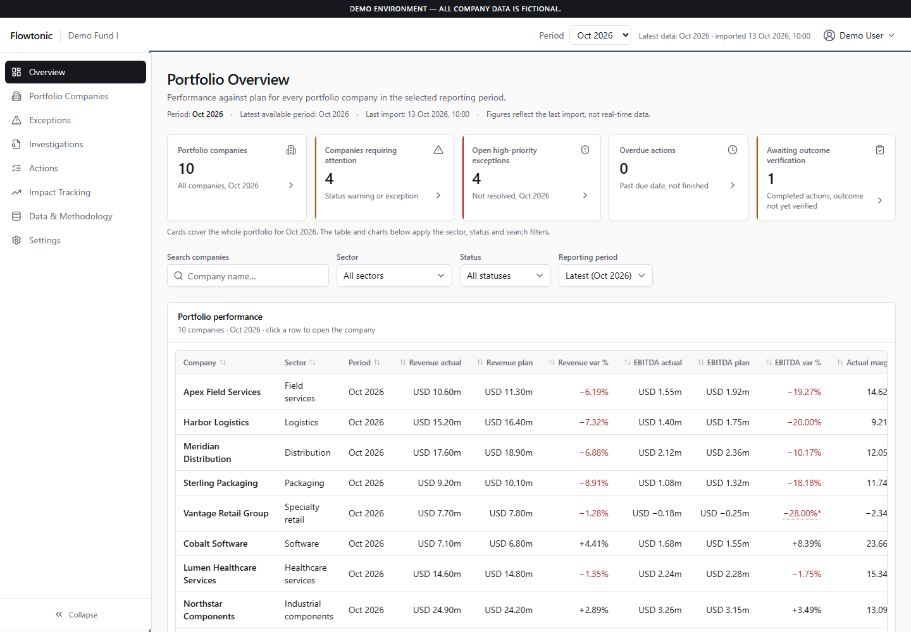
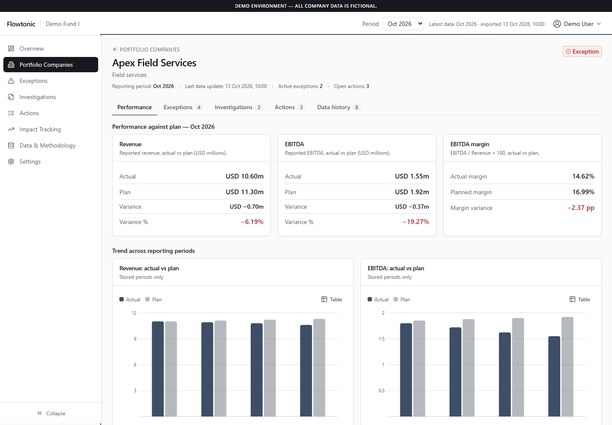
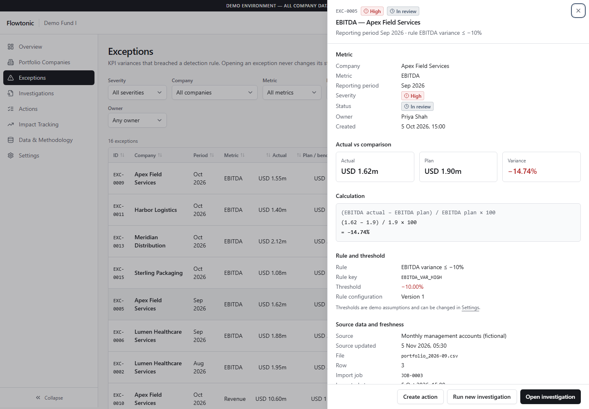
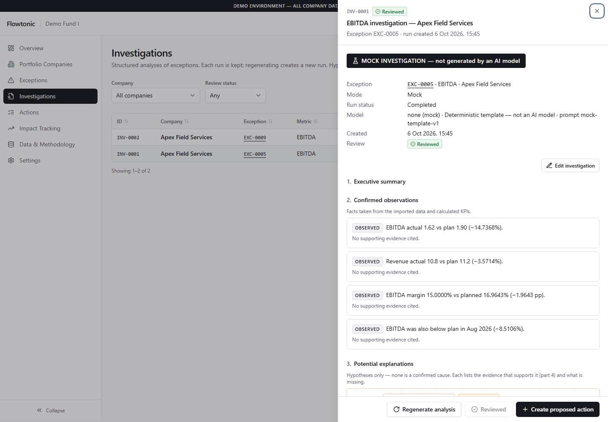
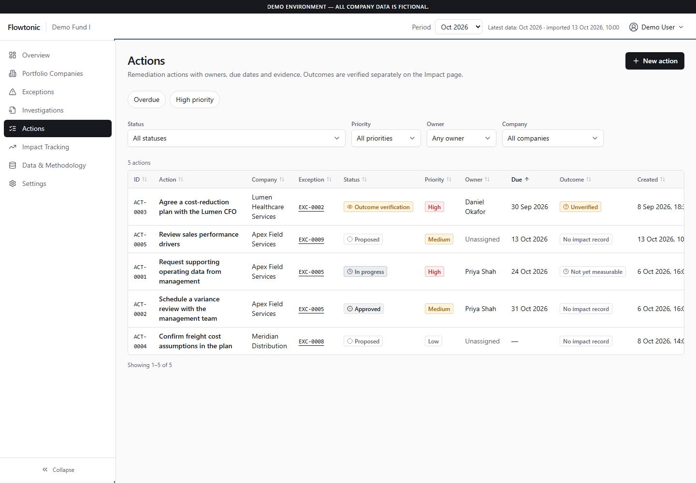
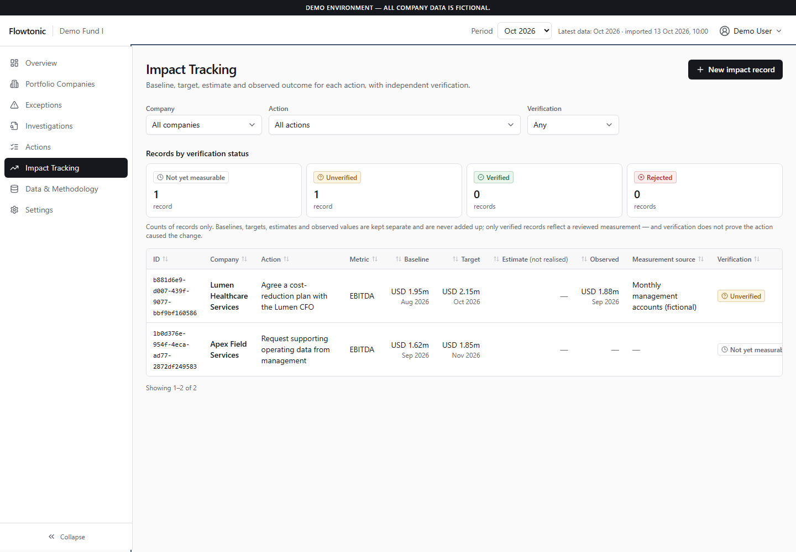
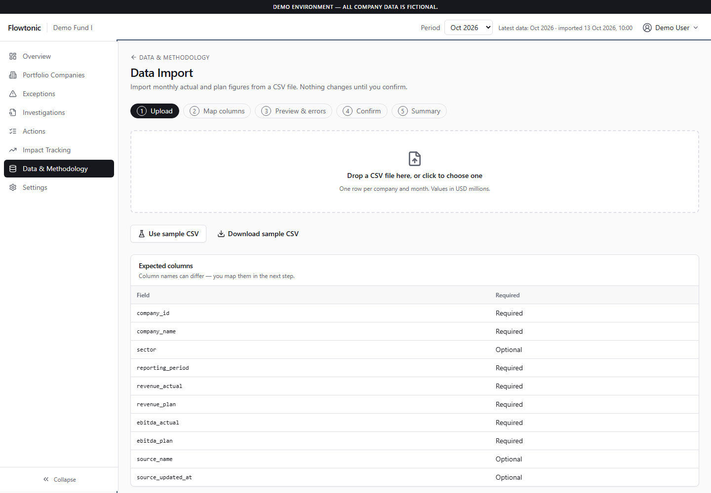
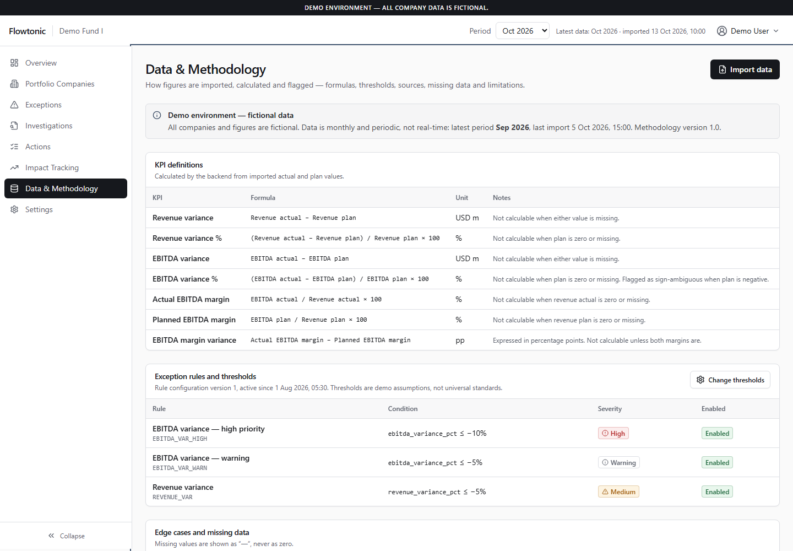

# Flowtonic

**Portfolio intelligence for private-equity teams.** Import monthly company figures, calculate performance against plan, flag material variances, investigate them with AI assistance, assign corrective actions and track whether those actions produced measurable results.

> **Sales prototype.** All company data is fictional. Not production-ready; see [Production.md](Production.md) before using real client data.



---

## What it does

```
Import CSV → Validate → Calculate KPIs → Detect exceptions → Investigate → Act → Track impact → Verify
```

| Step | How |
|---|---|
| **Import** | Upload a CSV, map its columns, preview every row with errors and warnings, then confirm. Nothing is saved until confirm, which runs as one database transaction. |
| **KPIs** | Revenue and EBITDA variance, margins and margin variance, calculated by a deterministic SQL function (`calc_kpis()`). No AI is used for any number. |
| **Exceptions** | Configurable rules (for example "EBITDA variance ≤ −10% → high") raise exceptions. Each one shows its formula, threshold and source row. |
| **Investigation** | Google Gemini (or a clearly labelled mock) separates confirmed facts from hypotheses and lists the missing evidence. The output is validated against a schema before it is saved. |
| **Actions** | Proposed → Approved → In progress → Completed → Outcome verification → Verified, with owners, due dates, notes and evidence. |
| **Impact** | Baseline, target and observed values are kept separate; a result stays "unverified" until a reviewer verifies it with evidence. |
| **Traceability** | Every displayed number can be traced back to its import job and CSV row; every change is in the audit history. |

---

## Tech stack

| Layer | Technology |
|---|---|
| Frontend | React 18 + TypeScript, Vite, TanStack Query, Radix UI, Tailwind CSS, Recharts |
| Backend | Python 3.14, FastAPI, psycopg 3 (connection pools) |
| Database | Supabase PostgreSQL with Row Level Security |
| AI | Google Gemini (`gemini-2.5-flash`) over REST, optional |

```
Flowtonic/
├── frontend/          React app (http://localhost:5173)
├── backend/           FastAPI server (http://localhost:8000)
│   ├── app/           routes, repository, imports/, investigations/, workflow/
│   └── scripts/       db-setup.mjs (migrate + seed), create_api_roles.py
├── database/
│   ├── migrations/    001–004 schema
│   ├── seed/          demo dataset (8 fictional companies, Jul–Sep 2026)
│   ├── roles/         read-only and write roles for the API
│   └── csv/           sample CSV files for testing the import
├── docs/screenshots/
├── Production.md      remaining work for production
└── flowtonic.txt      product specification
```

---

## Prerequisites

- **Python 3.14** (Windows: the `py` launcher)
- **Node.js 20+** (tested with 24)
- A **Supabase** project (free tier is fine)
- Optional: a **Google Gemini API key** for live AI investigations. Without one, the app offers the mock investigation only.

---

## Setup (first time)

### 1. Backend environment

```bash
cd backend
cp .env.example .env
```

Fill in `backend/.env`:

| Variable | Where to find it |
|---|---|
| `SUPABASE_URL`, `SUPABASE_KEY` | Supabase → Project Settings → API (publishable key) |
| `DATABASE_URL` | Supabase → Connect → Session pooler. Admin connection, used **only** by the setup scripts. URL-encode special characters in the password (`@` → `%40`). |
| `API_DATABASE_URL`, `API_WRITE_DATABASE_URL` | Written for you by `create_api_roles.py` (step 3) |
| `GEMINI_API_KEY` | Optional. Google AI Studio. Leave empty for mock-only mode. |

All of these stay on the server. The frontend never sees them.

### 2. Install backend dependencies

```bash
# in backend/
py -3.14 -m venv .venv
.venv/Scripts/python -m pip install -r requirements.txt   # macOS/Linux: .venv/bin/python
npm install                                               # for the database scripts
```

### 3. Create the database

```bash
# in backend/
npm run db:seed                                   # applies migrations 001–004 and loads the demo data
.venv/Scripts/python scripts/create_api_roles.py  # creates the read-only and write roles, writes their URLs to .env
```

If the roles already exist, run `npm run db:migrate` to apply only new migrations.

### 4. Frontend

```bash
cd frontend
npm install
cp .env.example .env    # VITE_API_BASE_URL=http://localhost:8000/api (the default)
```

---

## Run

Use two terminals.

```bash
# Terminal 1: API on http://localhost:8000 (interactive docs at /docs)
cd backend
.venv/Scripts/uvicorn app.main:app --reload --port 8000
```

```bash
# Terminal 2: web app on http://localhost:5173
cd frontend
npm run dev
```

Open **http://localhost:5173**. Check the API with `http://localhost:8000/api/health`; it should return `"database": "ok"`.

The API terminal prints a line for every request, plus numbered steps for imports, investigations and workflow changes, for example:

```
21:10:50.105 INFO  [req_781d8f] → POST /api/investigations
21:10:50.294 INFO  [req_781d8f]   investig 3/5 calling gemini-2.5-flash (timeout 45 s) …
21:11:01.610 INFO  [req_781d8f]   investig 3/5 done in 11315 ms → finish=STOP, tokens in=1052 out=2016
21:11:02.041 INFO  [req_781d8f] ← 201 POST /api/investigations (11935 ms)
```

---

## Reset the demo data

```bash
cd backend
npm run db:seed
```

**This deletes everything** (imports, investigations, actions, impact records and history) and restores the original 8 companies for Jul–Sep 2026. Tables, roles and keys are not touched.

---

## Demo walkthrough (spec §16)

1. **Overview**: portfolio KPI cards, company table and charts.
2. Open **Apex Field Services** and compare revenue and EBITDA with plan.
3. Open its **EBITDA exception**: the exact formula, the −10% threshold and the source row.
4. **Run an investigation**: mock (free) or live Gemini. Review the facts, hypotheses and missing evidence.
5. **Create a proposed action**, assign an owner and due date, and move it through its statuses.
6. **Add an impact record**: it stays "not yet measurable", then "unverified", until a reviewer verifies it with evidence.
7. Return to the **Overview**; the counts have changed.

To test the import, use the files in [database/csv](database/csv/README.md):

| File | Expected result |
|---|---|
| `company_monthly_metrics.csv` | 24 rows, all unchanged (same as the seed) |
| `company_monthly_metrics_2026-10_new_period.csv` | October data, 2 new companies, 8 new exceptions |
| `company_monthly_metrics_2026-09_restatement.csv` | 4 changed rows; exceptions raised, escalated and cleared |
| `company_monthly_metrics_invalid.csv` | Row-level errors and warnings |
| `company_monthly_metrics_mapped_headers.csv` | Different column names, auto-mapped |
| `company_monthly_metrics_missing_column.csv` | Rejected: required column missing |

---

## Screenshots

| | |
|---|---|
| **Company detail**: actual vs plan, variances and trend<br> | **Exception detail**: formula, rule, threshold and source<br> |
| **Investigation**: facts separated from hypotheses, mock clearly labelled<br> | **Action tracker**: status, owner, due date, verification<br> |
| **Impact tracking**: baseline, target, estimate and observed kept separate<br> | **CSV import**: upload, map, preview, confirm<br> |
| **Data & methodology**: formulas, rules, sources and limitations<br> | |

---

## Useful commands

| Command (from `backend/`) | Purpose |
|---|---|
| `npm run db:migrate` | Apply new migrations only |
| `npm run db:seed` | Migrations + reset to demo data (**deletes all data**) |
| `.venv/Scripts/python -m pytest` | API tests against the seeded database (read-only) |
| `.venv/Scripts/python database/csv/validate_csv.py` (from the project root) | Check the sample CSV files against the import rules |

| Command (from `frontend/`) | Purpose |
|---|---|
| `npm run dev` | Development server |
| `npm run build` | Type check and production build into `dist/` |

---

## Known limitations (demo)

- No login: every change is recorded as "Demo User".
- Single workspace; no roles or permissions.
- Expired import sessions are not cleaned up automatically.
- "Reset demo" in the app is not available; use `npm run db:seed`.
- Live AI sends fictional data to Google Gemini; each run costs a small amount.

The full list of production work (security, RBAC, error handling, observability) is in [Production.md](Production.md).
