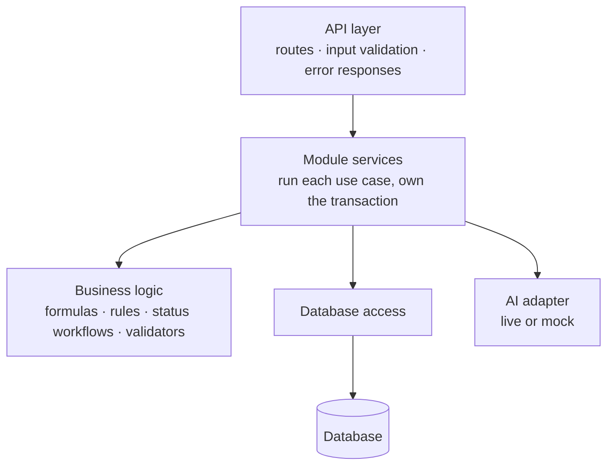
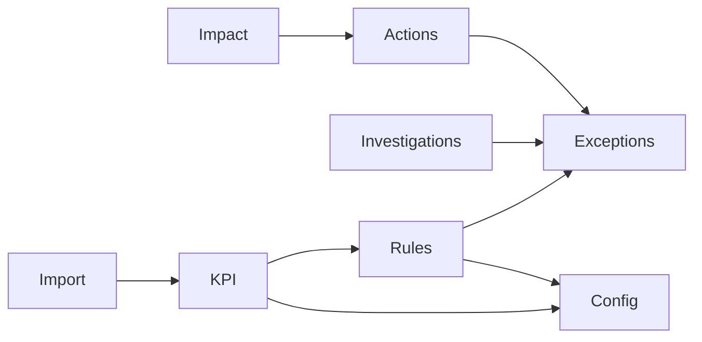
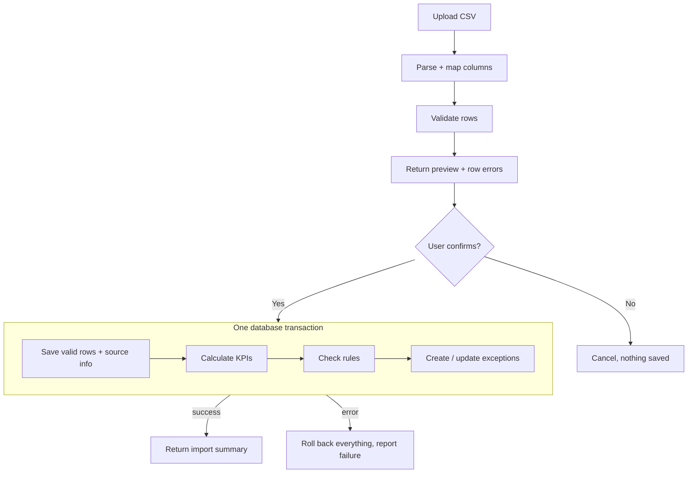
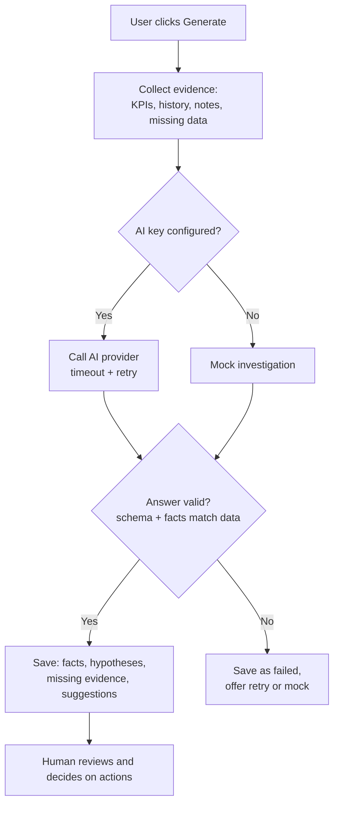
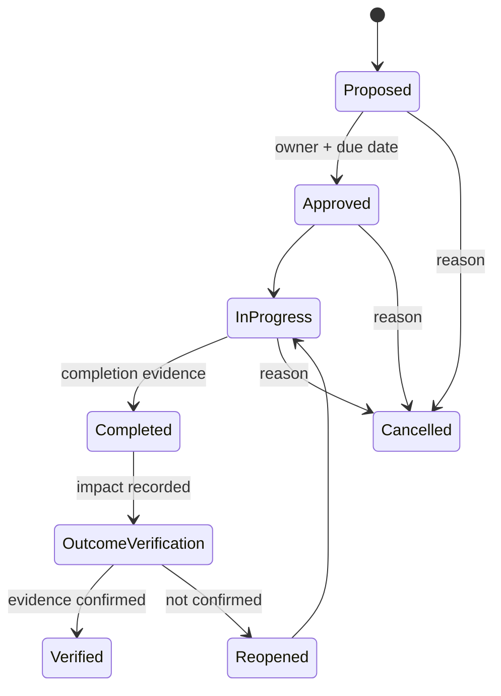

# Backend — System Design

The backend does all the work: it validates data, calculates KPIs, detects exceptions, runs investigations, and controls action and impact status. It is a **modular monolith**: one server with separate modules.

## Layers

## Modules

| Module | Job |
|---|---|
| Import | Read CSV, map columns, validate rows, preview, confirm or cancel |
| KPI | Calculate variances and margins (decimal maths, same input → same result) |
| Rules | Compare KPIs with the configured thresholds and create or update exceptions |
| Exceptions | Acknowledge, assign, resolve, reopen; keep history |
| Investigations | Collect evidence, call AI or mock, validate the answer, save it for human review |
| Actions | Proposed → Approved → In progress → Completed → Outcome verification → Verified / Reopened (or Cancelled) |
| Impact | Baseline, target and observed values; verification |
| Config | Thresholds, metric definitions, AI mode, demo reset |

## Main flows

### 1. CSV import → KPIs → exceptions

Invalid rows are never silently dropped. They are reported with row number, field and reason.

### 2. Investigation (AI or mock)

The AI never calculates numbers and never claims a cause without evidence.

### 3. Action and impact

An impact record starts as **unverified** (or **not yet measurable**). It becomes verified only when an observed value, its source, a reviewer and supporting evidence are recorded.

## API

| Group | Endpoints |
|---|---|
| Overview | `GET /overview` |
| Companies | `GET /companies`, `GET /companies/{id}` |
| Imports | `POST /imports`, `PUT /imports/{id}/mapping`, `POST /imports/{id}/confirm`, `POST /imports/{id}/cancel` |
| Exceptions | `GET /exceptions`, `GET /exceptions/{id}`, `POST /exceptions/{id}/transitions`, `GET /exceptions/{id}/trace` |
| Investigations | `POST /exceptions/{id}/investigations`, `GET /investigations/{id}`, `POST /investigations/{id}/review` |
| Actions | `POST /actions`, `PATCH /actions/{id}`, `POST /actions/{id}/transitions` |
| Impact | `POST /actions/{id}/impacts`, `POST /impacts/{id}/verification` |
| Config | `GET /methodology`, `GET/PUT /settings`, `POST /demo/reset`, `GET /health` |

Errors use one shape: `{ code, message, details, request_id }`. Status codes: `422` invalid input, `409` invalid status change.

## Backend rules

- API keys live only in server environment variables.
- Multi-step writes use one transaction: everything is saved or nothing is.
- Repeating an import or rule check never creates duplicates.
- Every status change is recorded in the audit history.
- Demo reset works only in the `demo` profile.
