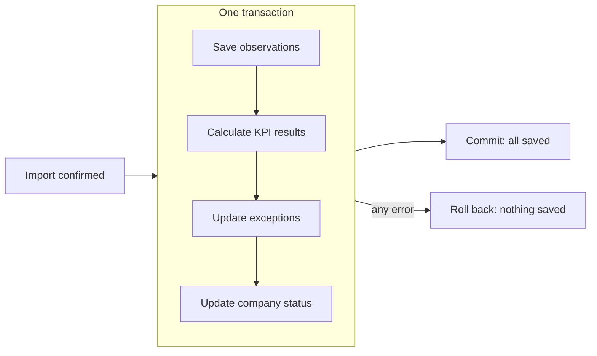

# Database — Design and ER Diagram

Based on the entities in [flowtonic.txt](../flowtonic.txt) §15.

## ER diagram

```mermaid
erDiagram
    PortfolioCompany ||--o{ KPIObservation : reports
    PortfolioCompany ||--o{ KPIResult : has
    PortfolioCompany ||--o{ Exception : raises
    DataSource ||--o{ ImportJob : "comes from"
    ImportJob ||--o{ KPIObservation : imports
    KPIObservation ||--o{ KPIResult : "calculated from"
    KPIObservation ||--o{ Exception : "flagged on"
    RuleConfiguration ||--o{ Rule : contains
    Rule ||--o{ Exception : triggers
    Exception ||--o{ Investigation : "investigated by"
    Exception ||--o{ Action : "addressed by"
    Investigation |o--o{ Action : suggests
    Action ||--o{ ImpactObservation : "measured by"

    PortfolioCompany {
        id id PK
        string name
        string sector
        string currency
        string status
        datetime created_at
        datetime updated_at
    }
    DataSource {
        id id PK
        string name
        string kind
    }
    ImportJob {
        id id PK
        id source_id FK
        string file_name
        string file_hash
        string status
        int rows_total
        int rows_imported
        int rows_invalid
        datetime imported_at
        string imported_by
    }
    KPIObservation {
        id id PK
        id company_id FK
        id import_job_id FK
        string metric_key
        decimal actual_value
        decimal plan_value
        string reporting_period
        string validation_status
        bool is_current
        datetime imported_at
    }
    KPIResult {
        id id PK
        id company_id FK
        id observation_id FK
        string kpi_key
        decimal value
        string calc_status
        string calc_reason
        string reporting_period
        datetime calculated_at
    }
    RuleConfiguration {
        id id PK
        int version
        bool is_active
        datetime activated_at
    }
    Rule {
        id id PK
        id configuration_id FK
        string rule_key
        string kpi_key
        decimal threshold
        string severity
        bool enabled
    }
    Exception {
        id id PK
        id company_id FK
        id observation_id FK
        id rule_id FK
        string metric_key
        string severity
        decimal variance_value
        string status
        string owner
        string resolution_reason
        datetime created_at
        datetime resolved_at
    }
    Investigation {
        id id PK
        id exception_id FK
        string mode
        string status
        json findings
        json hypotheses
        json missing_evidence
        json suggested_actions
        json model_metadata
        string analyst_notes
        string review_status
        datetime created_at
    }
    Action {
        id id PK
        id exception_id FK
        id investigation_id FK
        string title
        string description
        string priority
        string owner
        date due_date
        string status
        string completion_notes
        string evidence_reference
        string cancel_reason
        datetime created_at
        datetime updated_at
    }
    ImpactObservation {
        id id PK
        id action_id FK
        string metric_key
        decimal baseline_value
        string baseline_period
        decimal target_value
        string target_period
        decimal observed_value
        string observation_period
        string measurement_source
        string verification_status
        string reviewer
        string notes
    }
```

Not shown: `AuditEvent` (entity type, record ID, change, actor, timestamp), which records every status change.

## Entities

| Entity | Purpose | Key relationships |
|---|---|---|
| **PortfolioCompany** | A monitored company with its sector and currency | Has observations, KPI results and exceptions |
| **DataSource** | Where data came from (e.g. a CSV file) | Has import jobs |
| **ImportJob** | One upload: file, counts, outcome, who imported it and when | Creates observations |
| **KPIObservation** | Reported actual and plan values for one company, metric and period | Belongs to a company and an import job |
| **KPIResult** | A calculated value (variance or margin) with its status | Calculated from observations |
| **RuleConfiguration / Rule** | Versioned thresholds that define exceptions | Rules trigger exceptions |
| **Exception** | A metric that breached a threshold, plus its status | Links to the company, observation and rule |
| **Investigation** | One AI or mock analysis with its human review | Belongs to an exception |
| **Action** | Accountable corrective work | Belongs to an exception; may come from an investigation |
| **ImpactObservation** | Baseline, target and observed values, and whether they are verified | Belongs to an action |

## Important constraints

| Rule | Reason |
|---|---|
| Unique: company + metric + period (for current observations) | One current value per company, metric and period |
| Unique: company + period + KPI (for KPI results) | Calculated values are stored once |
| Unique: company + period + metric + rule (for exceptions) | Prevents duplicate exceptions when an import runs twice |
| Only one active `RuleConfiguration` | One set of thresholds applies at a time |
| Foreign keys on every relationship | No orphan records |
| Allowed values only for `status`, `severity` and `validation_status` | Invalid states cannot be stored |
| Decimal columns for money and percentages | Correct financial arithmetic |

## How data stays consistent

- **Corrections:** a new value marks the old observation as no longer current, instead of overwriting it, so history is kept.
- **Duplicate import:** the file hash is compared, so re-importing the same file adds no new records.
- **Traceability:** from an exception you can follow `rule → KPI result → observation → import job` back to the source file and row.

## Demo data

The seed loads the three fictional companies from [flowtonic.txt](../flowtonic.txt) §13 (Northstar Components, Apex Field Services, Meridian Distribution). KPI results and exceptions are **calculated** from them, never seeded directly. Demo reset clears and reseeds the data, and is disabled in the production profile.

## Open questions

| # | Question |
|---|---|
| 1 | Which calendar month does the demo data cover? The spec says only "one monthly period". |
| 2 | Should a CSV import create companies that don't exist yet, or must they be registered first? |
| 3 | Store `PortfolioCompany.status` (spec §15) or derive it from the exceptions each time? Storing it means updating it in the same transaction. |
