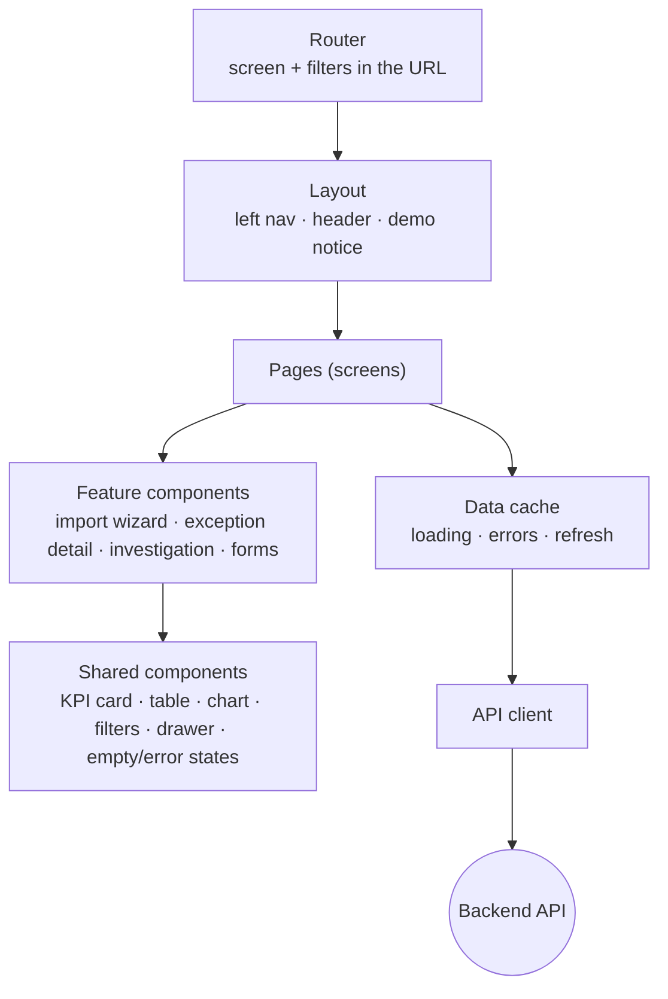
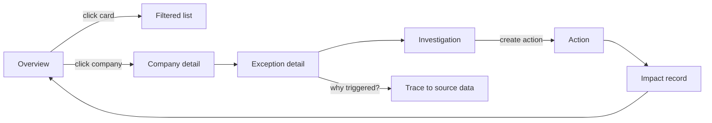
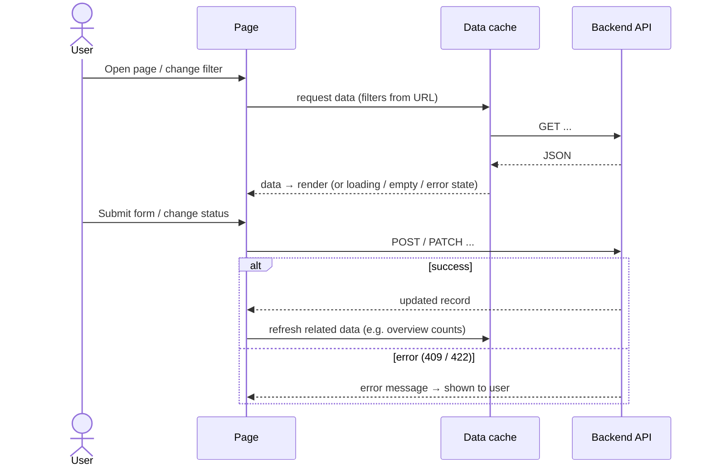

# Frontend — System Design

The frontend **displays** data and **sends** user actions to the backend. It does not calculate KPIs, apply rules or decide statuses.

## Layers

## Screens

| Screen | What it shows | Main API |
|---|---|---|
| Overview | 5 KPI cards, company table, charts | `GET /overview` |
| Portfolio Companies | Company list and detail with tabs | `GET /companies`, `GET /companies/{id}` |
| Exceptions | Exception table and detail (formula, threshold, source) | `GET /exceptions`, `GET /exceptions/{id}` |
| Investigations | AI or mock findings, notes, review | `POST /exceptions/{id}/investigations` |
| Actions | Action list, form, status changes | `POST /actions`, `POST /actions/{id}/transitions` |
| Impact Tracking | Baseline, target, observed values, verification | `POST /actions/{id}/impacts` |
| Data & Methodology | CSV import, formulas, thresholds, data sources | `POST /imports`, `GET /methodology` |
| Settings | Thresholds, AI mode, demo reset | `PUT /settings`, `POST /demo/reset` |

The header is visible on every screen and shows:

* the workspace;
* the reporting-period selector;
* data freshness (last import time);
* the demo user;
* the notice "DEMO ENVIRONMENT — ALL COMPANY DATA IS FICTIONAL."

## User flow

## How a screen loads and updates data

## Rules for the frontend

- Show missing values as "—", never as 0.
- Label AI output **"AI-generated"** and mock output **"MOCK — not generated by an AI model"**.
- Never store API keys or secrets. The frontend talks only to our backend.
- Every page needs loading, empty and error states. No dead buttons.
- Responsive (desktop and mobile), keyboard accessible, readable contrast.
