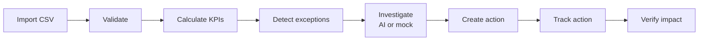
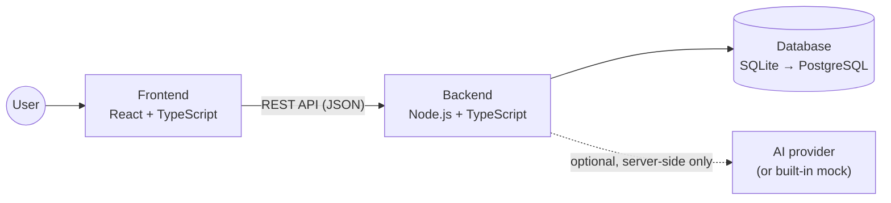

# Flownetic Portfolio Intelligence — System Overview

> Proposed design. Nothing is implemented yet. Requirements: [flowtonic.txt](flowtonic.txt).
> Sales demo with fictional data. Not production-ready.

## What the system does

Flownetic helps a private equity team see which portfolio companies are off plan, investigate why, assign corrective actions, and check whether those actions worked.



## How the system is built

Three parts: a **frontend** that shows data, a **backend** that does the work, and a **database** that stores everything.



| Part | Responsibility | Details |
|---|---|---|
| Frontend | Screens, charts, tables, forms. Shows results; no calculations. | [frontend/system.md](frontend/system.md) |
| Backend | CSV import and validation, KPI calculation, exception rules, AI investigation, action and impact workflow | [backend/system.md](backend/system.md) |
| Database | Stores companies, imported data, exceptions, investigations, actions, impact records and history | [database/system.md](database/system.md) (ER diagram) |

## Technology and methods

| Area | Choice | Why |
|---|---|---|
| Architecture | **Modular monolith**: one backend app with separate modules | Simple to build and run; import → calculate → detect can be saved in one transaction |
| Frontend | React + TypeScript single-page app, charting library | Required by the spec; reusable components |
| Backend | Node.js + TypeScript REST API | Same language as the frontend; shared types |
| Database | SQLite for the demo, PostgreSQL for production | Small and simple now; relational and robust later |
| Calculations | Done only on the backend with decimal maths; never by the AI | Same input always gives the same result |
| AI | Backend adapter: live AI provider, or a clearly labelled mock | API keys stay on the server; output is validated before use |
| Validation | Shared schema library (e.g. Zod) | Same checks for CSV rows, API requests and AI output |
| Testing | Unit, integration and Playwright end-to-end tests | Spec §17 acceptance checks |

## Key rules

- Every number on screen comes from the database through the backend.
- The AI only suggests. A human creates and approves actions.
- An impact stays **unverified** until supporting evidence is recorded.
- The notice "DEMO ENVIRONMENT — ALL COMPANY DATA IS FICTIONAL." is always shown.

## Project structure

```
Flowtonic/
├── system.md          ← this overview
├── flowtonic.txt      ← product requirements
├── frontend/          ← README.md, system.md
├── backend/           ← README.md, system.md
└── database/          ← README.md, system.md (ER diagram)
```
